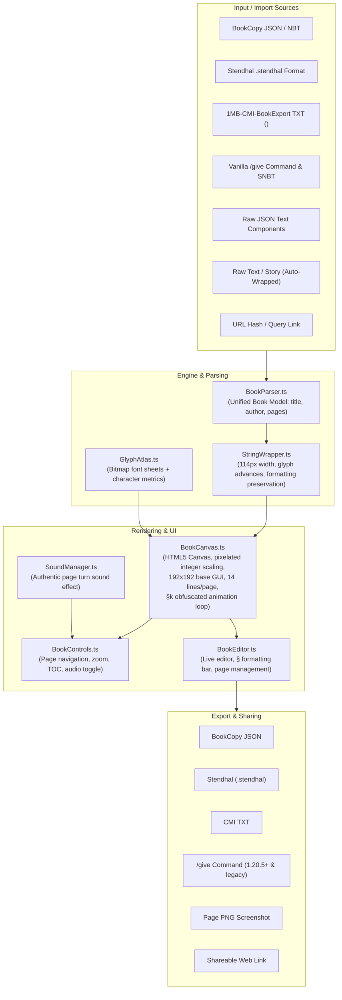
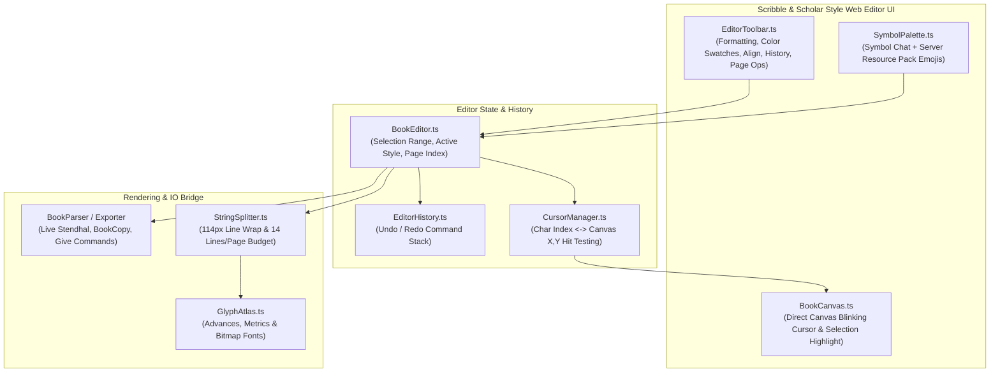

# Implementation Plan - Minecraft Written Book Web Emulator & Viewer (minecraft-magazine)

A web application that emulates Minecraft written books with pixel-perfect bitmap font rendering, authentic book UI, exact layout constraints (114px wrap width, 14 lines per page), formatting codes (`§0-f`, `§l-o`, `§k`), single/two-page spread toggle, and comprehensive import/export workflows for in-game books.

---

## Goal Description

In Minecraft, written books and books & quills utilize a custom bitmap font with variable glyph widths, strict pagination rules (maximum 114 pixels width per line, 14 lines per page), and formatting codes (`§` or modern text components). Players and server administrators author rich in-game content (guides, server rules, lore, magazines, comics), but sharing this content outside the game is difficult.

The goal is to build a responsive, authentic web application in `/Users/ethanchan/Documents/Applications/minecraftwebsites/minecraft-magazine` that:
1. **Faithfully Emulates the In-Game Book Screen**:
   - Uses genuine extracted Minecraft textures (`book.png`, page turning arrow buttons) rendered with pixelated scaling.
   - Accurately renders Minecraft's variable-width bitmap font (`ascii.png`, `accented.png`, `nonlatin_european.png`) matching the logic in `net.minecraft.client.gui.font.providers.BitmapProvider`.
   - Enforces vanilla layout rules from `BookViewScreen.java`: text area at $(36, 30)$, width 114px, line height 9px, exactly 14 lines per page, and page indicator at $(148, 16)$.
   - Handles full formatting codes: 16 standard Minecraft colors, hex colors (`&#RRGGBB` / `§x...`), styles (`§l` bold with 1px horizontal stamp and +1px advance, `§o` italic, `§n` underline, `§m` strikethrough, `§r` reset), and animated `§k` obfuscated text.
   - Includes a **Two-Page Spread Toggle** (switching between 1-page vanilla view and open 2-page book view).
2. **Seamlessly Imports Book Content Exported from Minecraft**:
   - **BookCopy mod JSON** (`SavedBook.java` codec: `{ "title": "...", "author": "...", "pages": [...] }`).
   - **CMI BookExport plugin TXT** (`<AutoPage> ... <NextPage> ...`).
   - **Vanilla `/give` commands & SNBT** (both 1.20.5+ component syntax `[written_book_content={...}]` and pre-1.20.5 NBT `{pages:['{"text":"..."}']}`).
   - **Minecraft JSON Text Components** (`{"text":"...", "color":"...", "extra":[...]}`).
   - **Raw Text / Markdown**: Automatic text wrapper that paginate-splits long texts at 114px width and 14 lines/page using Minecraft character advances.
   - **Drag-and-drop file upload** (`.json`, `.txt`, `.nbt`, `.stendhal`).
3. **Interactive Reader & In-Browser Book Editor**:
   - Page flipping with animated buttons, keyboard navigation (Left/Right arrows), touch swipe, and authentic page turn sound effects.
   - Book metadata display (Title, Author, Generation: Original / Copy of Original).
   - In-browser editor mode with formatting toolbar (color palette, bold/italic/underline/etc.), page insertion/deletion, line/width indicator, and live preview.
4. **Export Back to Minecraft & Web Sharing**:
   - Export to BookCopy JSON, CMI `<NextPage>` TXT, Stendhal `.stendhal`, Vanilla `/give` command.
   - Shareable book URLs via URL hash / query parameter encoding.
   - Export high-resolution PNG image / screenshot of any page or open spread.

---

## User Alignment & Configuration
- **Project Directory**: `/Users/ethanchan/Documents/Applications/minecraftwebsites/minecraft-magazine`
- **View Modes**: Single page view (vanilla 1:1) and Two-Page Spread view (side-by-side pages).
- **Test Books**: Bundled rich sample books (Lore Book with §k, Handbook, Magazine issue preview) with seamless import support for the user's provided books.

---

## Proposed Architecture



---

## Proposed Changes

### Component 1: Project Setup & Assets (`minecraft-book/`)

#### [NEW] `package.json`
- Vite, TypeScript, and Bun/npm build scripts.
- No heavy third-party UI framework needed; lightweight reactive state and modular TypeScript components ensure peak performance and zero bundle bloat.

#### [NEW] `vite.config.ts`
- Base URL configuration (works with static file serving and GitHub Pages).
- Asset optimization and build settings.

#### [NEW] `public/assets/`
- `textures/gui/book.png`: The authentic 192x192 book GUI texture.
- `textures/gui/page_forward.png`, `page_forward_highlighted.png`: Next page button.
- `textures/gui/page_backward.png`, `page_backward_highlighted.png`: Previous page button.
- `textures/font/ascii.png`: Standard ASCII glyph sheet.
- `textures/font/accented.png`: Accented Latin characters glyph sheet.
- `textures/font/nonlatin_european.png`: Cyrillic, Greek, Hebrew, and extended glyph sheet.
- `font/glyphs.json`: Precomputed character advance table (from Minecraft and `BitmapProvider.java`).
- `sounds/page_turn.mp3`: Minecraft book page flip audio.

---

### Component 2: Font & Text Layout Engine (`src/engine/`)

#### [NEW] `src/engine/types.ts`
- Book interface:
  ```typescript
  export interface MinecraftBook {
    title: string;
    author: string;
    generation?: number; // 0 = Original, 1 = Copy of original, 2 = Copy of copy, 3 = Tattered
    pages: string[];     // Formatted page strings with § formatting codes or raw components
  }
  
  export interface FormattedSpan {
    text: string;
    color: string;
    bold: boolean;
    italic: boolean;
    underlined: boolean;
    strikethrough: boolean;
    obfuscated: boolean;
  }
  
  export interface LineLayout {
    spans: FormattedSpan[];
    width: number;
  }
  ```

#### [NEW] `src/engine/GlyphAtlas.ts`
- Loads `ascii.png`, `accented.png`, and `nonlatin_european.png`.
- Analyzes pixel data to calculate exact character glyph bounding boxes and advances (`width + 1`, space = `4px`).
- Provides glyph blitting metadata: source sheet, `srcX`, `srcY`, `width`, `height`, `advance`.

#### [NEW] `src/engine/Formatting.ts`
- Color definitions:
  - 16 Minecraft colors (`§0` #000000, `§1` #0000AA, ..., `§f` #FFFFFF).
  - Modern hex color parsing: `§x§R§R§G§G§B§B` and `&#RRGGBB` and `#RRGGBB`.
- Style codes (`§l`, `§o`, `§n`, `§m`, `§k`, `§r`).
- State machine to parse strings into formatted token streams while correctly honoring Minecraft's rule that color codes reset all active styles.

#### [NEW] `src/engine/StringSplitter.ts`
- Port of Minecraft's `StringSplitter.java` and `createStringWrapper.ts`:
  - Enforces `TEXT_WIDTH = 114` pixels.
  - Correctly accounts for bold character spacing (`advance + 1`).
  - Splits at spaces when possible; breaks long words when required.
  - Carries over active text formatting across soft line breaks.
  - Respects explicit `\n` newlines.
  - Splits formatted pages into arrays of up to 14 lines (`128 / 9 = 14`).

---

### Component 3: Multi-Format Parser & Exporter (`src/io/`)

#### [NEW] `src/io/BookParser.ts`
- **BookCopy JSON parser**: Detects `{ title, author, pages }` structure.
- **Stendhal parser**: Detects `title:`, `author:`, and `#- ` page markers.
- **CMI BookExport parser**: Detects `<AutoPage>` and splits on `<NextPage>`, stripping metadata comments or parsing headers.
- **Vanilla `/give` / SNBT parser**:
  - Handles `/give @p written_book[written_book_content={...}]` (1.20.5+).
  - Handles `/give @p written_book{pages:[...], title:"...", author:"..."}` (1.13 - 1.20.4).
  - Extracts escaped JSON text components (`{"text":"...", "color":"..."}`) and translates them into styled strings.
- **Plain Text / Story wrapper**: Splits raw text into 14 lines per page using Minecraft font widths.
- **Auto-detection**: Automatically detects which format was pasted or uploaded.

#### [NEW] `src/io/BookExporter.ts`
- Generates BookCopy JSON file.
- Generates Stendhal `.stendhal` file.
- Generates CMI CustomText `<NextPage>` file.
- Generates vanilla `/give` command (both modern 1.20.5+ and legacy formats).
- Generates compressed URL hash for sharing (using LZ-string or Base64URL).

---

### Component 4: Rendering & Audio (`src/render/`)

#### [NEW] `src/render/BookCanvas.ts`
- Implements canvas rendering of `BookViewScreen`:
  - 192x192 base resolution with integer or smooth scaling (2x, 3x, 4x, or CSS pixelated resize).
  - Renders `book.png` background at $(0, 0)$.
  - Renders right-aligned "Page X of Y" at $(148, 16)$ with vanilla font.
  - Renders text lines starting at $(36, 30)$, spaced 9px vertically for up to 14 lines.
  - Draws custom colored glyphs with color tinting cache.
  - Draws bold characters with 1px horizontal offset.
  - Draws underline at baseline + 1px and strikethrough at midpoint.
  - Obfuscated `§k` text: dynamic animation loop swapping random glyphs of identical width on each frame.
  - Renders forward and backward page buttons at $(116, 157)$ and $(43, 157)$ with hover states.
- Click detection on page buttons and keyboard arrow key listener.

#### [NEW] `src/render/SoundEffects.ts`
- Plays genuine Minecraft page turn sound effect on page changes.
- Supports Web Audio API fallback synthesis if audio files are blocked or muted.

---

### Component 5: User Interface & Editor (`src/ui/`)

#### [NEW] `src/ui/BookViewer.ts`
- Main container layout:
  - Realistic Minecraft-themed desk/wood backdrop.
  - Top bar with Book Title, Author, and Page Jump dropdown.
  - Floating controls: Zoom (1x, 2x, 3x, 4x, Fit), Sound Toggle, Fullscreen, Single/Two-Page Spread Toggle.
  - Bottom action bar: Import Book, Export Book, Edit Book, Share Link.

#### [NEW] `src/ui/ImportModal.ts`
- Drag-and-drop file upload zone for `.json`, `.txt`, `.stendhal`.
- Multi-tab text paste modal: Auto-detect, Stendhal, BookCopy JSON, CMI BookExport, /give command, or Plain Text.
- Real-time format validation and page preview.

#### [NEW] `src/ui/ExportModal.ts`
- Tabbed exporter:
  - Copy `/give` command (1.20.5+ or Legacy) with one click.
  - Download Stendhal `.stendhal`.
  - Download BookCopy `.json`.
  - Download CMI `<NextPage>` `.txt`.
  - Copy Shareable URL.
  - Export Current Page as PNG Image.

#### [NEW] `src/ui/EditorModal.ts`
- Interactive book authoring/editing:
  - Edit Title and Author.
  - Live page textarea with Minecraft formatting helper toolbar:
    - 16 Minecraft colors palette buttons.
    - Style buttons: Bold (`§l`), Italic (`§o`), Underline (`§n`), Strike (`§m`), Obfuscate (`§k`), Reset (`§r`).
  - Page manager: Add Page, Delete Page, Reorder Pages.
  - Real-time line count indicator (`X / 14 lines`) and line width overflow warning if any line exceeds 114px.
  - Instant live rendering in the canvas preview!

#### [NEW] `src/main.ts` & `index.html`
- Application entry point.
- Bundled sample books:
  - "The Art of Redstone" (rich colors, diagrams, bold).
  - "Ancient Tome" (mysterious lore featuring `§k` obfuscated runes).
  - "Server Rules & Handbook" (CMI-style guide).
- URL hash router for instant loading of shared books.

---

## Verification Plan

### Automated Tests
We will add automated tests using Bun / Vitest for core formatting and layout calculations:
- `StringSplitter.test.ts`:
  - Verify wrap width at 114 pixels with various character combinations.
  - Verify bold character advance (`+1px`).
  - Verify style retention across soft line wraps.
  - Verify exact 14 lines per page cutoff.
- `BookParser.test.ts`:
  - Test parsing BookCopy JSON fixture.
  - Test parsing Stendhal `.stendhal` files.
  - Test parsing 1MB-CMI-BookExport TXT with `<NextPage>` markers.
  - Test parsing Minecraft 1.20.5+ `/give` command with `written_book_content`.
  - Test parsing legacy 1.20.4 `/give` command with escaped JSON components.
- `BookExporter.test.ts`:
  - Verify round-trip conversion: Parse -> Export -> Re-parse matches original text and pages.

Commands:
```bash
cd /Users/ethanchan/Documents/Applications/minecraftwebsites/minecraft-magazine
bun test
```

### Manual Verification
1. **Visual Accuracy**:
   - Inspect the book canvas rendered in browser at 1x, 2x, 3x, and 4x scale.
   - Verify font pixel crispness (no blurriness), proper character kerning, and exact 114px line boundaries.
   - Verify page indicator text "Page 1 of X" right-aligned at $(148, 16)$.
   - Verify previous/next arrow button positions and hover states.
2. **Formatting & Animation**:
   - Verify all 16 colors display accurately.
   - Verify `§l` (bold) stamps an extra pixel to the right and shifts next character advance.
   - Verify `§k` (obfuscated) animates continuously on screen.
   - Verify `§r` resets formatting.
3. **Import Workflows**:
   - Import a Stendhal `.stendhal` file.
   - Import a BookCopy `.json` file.
   - Import a CMI `<NextPage>` `.txt` file.
   - Paste a modern `/give` command.
   - Paste raw long text and verify it cleanly wraps and paginates into 14 lines per page.
4. **Export Workflows**:
   - Copy generated `/give` command and verify format syntax.
   - Download Stendhal `.stendhal`, BookCopy JSON, and CMI TXT.
   - Click "Share Link" and open the URL in a new tab; verify the book loads identically.
5. **Interactive Editor**:
   - Insert new pages, type text using the color and style buttons, and verify the live canvas updates in real time.

---

## Phase 6: Scribble & Scholar Style In-Book WYSIWYG Web Editor

### 1. Overview & Inspiration
The current web app includes a basic popup modal editor with a raw `<textarea>`. To provide an authentic, modern authoring experience, we are planning a full **in-place WYSIWYG book editor** inspired by the two best Minecraft book editing mods:
- **Scribble** ([`me.chrr.scribble`](file:///Users/ethanchan/Documents/Applications/minecraftprojects/bookstuff/scribble/common/src/main/java/me/chrr/scribble/)): Direct rich text editing, interactive blinking cursor, text selection highlighting, 16-color swatches, modifier buttons, undo/redo history (`Ctrl+Z`/`Ctrl+Y`), and page management (insert, duplicate, move, delete).
- **Scholar** ([`io.github.mortuusars.scholar`](file:///Users/ethanchan/Documents/Applications/minecraftprojects/bookstuff/Scholar/common/src/main/java/io/github/mortuusars/scholar/)): Two-page spread editing (`SpreadBookEditScreen`), horizontal alignment controls (Left, Center, Right), integrated formatting toolbar, and bookmark navigation.
- **Symbol Chat & Server Pack Emojis**: Direct symbol & emoji insertion palette embedded in the editor toolbar to easily insert runes, combat icons, and server-specific emojis (`\uE109`, `\uE155`, etc.).



---

### 2. Key Modules & Architecture

#### A. Editor State & Controller (`src/editor/BookEditor.ts`)
- **State Model**:
  - `activePageIndex`: Current page being edited (in two-page mode, left or right).
  - `cursorIndex`: Character offset within the current page.
  - `selectionStart` & `selectionEnd`: Character range for selection.
  - `activeStyle`: Current typing formatting state (`{ color, bold, italic, underline, strikethrough, obfuscated }`).
  - `isEditing`: Boolean toggle between Reader mode and Editor mode.
- **Selection & Formatting Logic**:
  - If a text range is selected: Clicking a color swatch or style button immediately formats the selected characters.
  - If no selection: Clicking a color or style toggles `activeStyle` for characters typed next (matching Scribble's `RichEditBox`).

#### B. Hit-Testing & Cursor Management (`src/editor/CursorManager.ts`)
- **Pixel-Accurate Coordinate Mapping**:
  - Maps any click coordinate $(X, Y)$ on the parchment to the nearest character index on the nearest line.
  - Computes the visual bounding box for any character slice:
    - Cursor line $Y$: $30 + \text{lineIndex} \times 9$.
    - Cursor $X$: $\text{startX} + \sum \text{advances}$.
- **Blinking Caret**:
  - Draws authentic 1px Minecraft cursor (`_` or `|`) at $(X, Y)$ with a 500ms blink timer.
- **Selection Highlight**:
  - Draws semi-transparent blue rectangles (`rgba(0, 40, 180, 0.4)`) behind selected text characters before blitting glyphs.

#### C. Floating / Integrated Toolbar (`src/editor/EditorToolbar.ts`)
- **Scribble Color Palette**:
  - 16 color buttons (`§0` through `§f`) with active border highlight.
  - Custom Hex Picker button (`#...`).
- **Style Modifiers**:
  - **B** (`§l`), *I* (`§o`), <u>U</u> (`§n`), ~~S~~ (`§m`), 𝓞 (`§k`), ↺ (`§r`).
- **Scholar Alignment Controls**:
  - Left Align, Center Align, Right Align (pads lines or stores alignment metadata).
- **Undo / Redo Controls (`EditorHistory.ts`)**:
  - `Undo` (`Ctrl+Z`), `Redo` (`Ctrl+Y` / `Cmd+Shift+Z`).
  - Command stack preserving document delta snapshots.
- **Page Operation Controls**:
  - `+ Add Page`: Inserts blank page after current page.
  - `- Delete Page`: Removes current page (with undo support).
  - `Duplicate Page`: Copies current page.
  - `← Move Left` / `Move Right →`: Reorders page sequence.
- **Budget Indicator**:
  - Real-time line counter: `Line X / 14`.
  - Current line width meter: `XXX px / 114 px` (turns orange when near boundary, red if exceeded).

#### D. Symbol & Emoji Insertion Palette (`src/editor/SymbolPalette.ts`)
- Compact dropdown / popover attached to a `★` toolbar button.
- Tabs matching Symbol Chat:
  - **Favorites & Common**: `★ ✦ ✪ ☠ ⚡ ❄ ⚔ 🛡 🏹 🗡 ♩ ♪ ♫ ♬`
  - **Arrows & Shapes**: `← ↑ → ↓ ↔ ↕ ↖ ↗ ↘ ↙ ↺ ↻ ╔ ═ ╗ ╚ ╝`
  - **Runes & Numbers**: `ᚠ ᚢ ᚦ ᚨ ᚱ ᚲ ① ② ③ ④ ⑤ ⑥ ⑦ ⑧ ⑨ ⑩`
  - **Server Emojis**: All custom bitmap providers loaded from the active resource pack (e.g. Craftadia `\uE109` logo, `\uE155` money jar, `\uEA71` clover, and tags).
- Clicking any symbol inserts it directly into the active cursor position with the active formatting.

#### E. Two-Page Spread Editing
- In two-page mode (`double`), both the left page ($X = 42$) and right page ($X = 171$) are editable.
- Clicking on the left page activates editing on Page $N$; clicking on the right page activates editing on Page $N+1$.
- Pressing `Page Down` or `Page Up` flips the spread while maintaining cursor continuity.

---

### 3. Implementation Steps

1. **Step 1: Editor State Engine & Cursor Math**
   - Create `src/editor/types.ts` and `src/editor/CursorManager.ts`.
   - Implement $(X, Y) \leftrightarrow \text{Index}$ hit-testing using `GlyphAtlas` advances.
   - Implement selection bounding boxes and cursor drawing on canvas.

2. **Step 2: Keyboard & Input Event Handling**
   - Create `src/editor/BookEditor.ts`.
   - Handle text typing, Enter (newlines up to 14 lines), Backspace/Delete, Arrow navigation, Home/End, Select-All (`Ctrl+A`), Copy (`Ctrl+C`), Cut (`Ctrl+X`), Paste (`Ctrl+V`).

3. **Step 3: Undo / Redo Command History**
   - Create `src/editor/EditorHistory.ts`.
   - Record typed text chunks, deletions, formatting changes, and page modifications.

4. **Step 4: Scribble & Scholar Toolbar Component**
   - Create `src/editor/EditorToolbar.ts` and styling in `src/styles.css`.
   - Wire up the 16-color swatches, style toggle buttons, alignment buttons, and page management actions.

5. **Step 5: Symbol Chat & Server Pack Emoji Popover**
   - Create `src/editor/SymbolPalette.ts`.
   - Populate from `SymbolManager` symbol lists and active `GlyphAtlas` custom bitmap glyphs.

6. **Step 6: Integrate with `BookViewer.ts` and `BookCanvas.ts`**
   - Replace the legacy `EditorModal` with seamless in-book canvas editing.
   - Support both single page and two-page spread editing.
   - Update export/import synchronization so changes reflect live in real-time.

7. **Step 7: Verification & Testing**
   - Unit tests for cursor mapping, selection ranges, and undo/redo history.
   - Verify typing across 14 lines and 114px line wrap boundaries.
   - Build verification.
