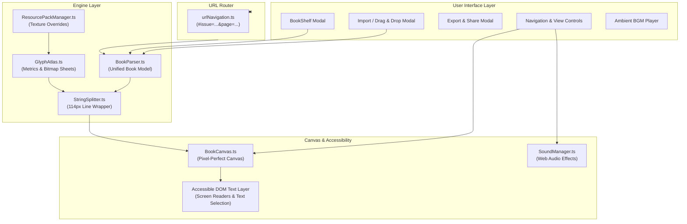

# Website Architecture & Features Specification

This document provides a technical walkthrough of the **Witch-Craft Magazine / Minecraft Book Viewer** web application, detailing its architecture, rendering pipeline, interactive features, and accessibility tooling.

---

## 1. System Architecture

The application is structured into modular layers located in `src/`:

```
src/
├── engine/              # Pure game logic, font metrics, text splitting & pagination
│   ├── types.ts              # Unified book models, spans, layout data structures
│   ├── Formatting.ts         # Section symbol (§) parsing, Bedrock & hex color resolution
│   ├── GlyphAtlas.ts         # Multi-sheet bitmap atlas, glyph_sizes.bin, character advances
│   ├── StringSplitter.ts     # 114px line wrapper, word break finder, pagination engine
│   ├── ResourcePackManager.ts# Resource pack layering & custom bitmap texture loader
│   └── glyphSizesData.ts     # BMP 65,536-character glyph sizes extracted from Minecraft
├── io/                  # Import & export adapters
│   ├── BookParser.ts         # Stendhal, BookCopy JSON, CMI, /give command, and raw text parsers
│   └── BookExporter.ts       # Serialization back to Stendhal, JSON, CMI, and /give syntax
├── render/              # Canvas rasterization & drawing
│   ├── BookCanvas.ts         # Canvas renderer, single/double spread layouts, glyph drawing
│   └── SoundManager.ts       # Web Audio API sound effects (page flip, book opening)
├── ui/                  # UI components and controllers
│   ├── BookShelfModal.ts     # Magazine issue selector & library browser
│   ├── ExportModal.ts        # Export modal with tabs for Stendhal, JSON, CMI, /give, image
│   ├── ImportModal.ts        # Drag-and-drop file upload & text paste modal
│   ├── AudioPlayer.ts        # YouTube Music ambient soundtrack integration
│   └── urlNavigation.ts      # URL router, hash state synchronization, shareable link generator
└── main.ts              # Application bootstrap & lifecycle management
```

### Architectural Flowchart



---

## 2. Rendering Pipeline & Visual Modes

### 2.1. Pixel-Perfect Integer Scaling
- Rendered via an HTML5 `<canvas>` using `image-rendering: pixelated` (`crisp-edges`).
- Drawing operations snap to integer pixel coordinates to prevent anti-aliasing blur.
- Canvas backing buffer runs at exact Minecraft GUI dimensions ($146 \times 180$ in single-page; $344 \times 180$ in double-page mode), scaled up cleanly using CSS transforms.

### 2.2. View Modes: Single-Page vs. Two-Page Spread
1. **Single-Page View (Vanilla Parity)**:
   - Emulates the exact in-game book screen ($146 \times 180\text{ px}$).
   - Left navigation button at $(X=23, Y=158)$, Right navigation button at $(X=116, Y=158)$.
   - Text region centered with vanilla margin offsets.
2. **Two-Page Spread View (Open Magazine View)**:
   - Displays companion left and right pages side-by-side ($344 \times 180\text{ px}$).
   - Seamless book spine transition eliminating texture seam artifacts.
   - Symmetrical navigation buttons positioned on the far left of the left page and the far right of the right page.

---

## 3. Interactive Features & Easter Eggs

### 3.1. Witchcraft Blinking Eye Easter Egg
- **Trigger**: Authored books by `StarSweetpea` (Witch-Craft Magazine) featuring the iconic runic eye symbol (`⏼` `U+23FC`).
- **Behavior**:
  - The eye occasionally blinks into `◡` (`U+25E1`) using an authentic randomized timer.
  - Clicking on the eye symbol directly triggers an immediate interactive wink.
  - The eye hitboxes are tracked during render without causing text reflow (both `⏼` and `◡` share an identical 8px advance).

### 3.2. Animated Issue Ending Spread
- In double-page mode for odd-numbered magazine issues that end on a left-hand page, the blank right-hand page displays an authentic animated StarSweetpea celebration GIF (`docs/localgitignorethis/starsweetpea.gif`).

### 3.3. Audio Experience
- **Page Flip Sound Effects**: Synthesized or sampled authentic Minecraft page flip sounds triggered via Web Audio API on page changes.
- **Ambient YouTube Music Embed**: Integrated player widget with volume control, track selector, and persistent background playback.

### 3.3. Animated ASCII Ambient Backdrop System
- **Peripheral Atmosphere**: Displays a tranquil, animated ASCII backdrop in the negative space outside the book canvas.
- **Book Boundary Masking**: Characters strictly stop at the perimeter of the book canvas (plus a 16px buffer), guaranteeing zero text or noise peeking beneath or behind the open pages.
- **Hypnotic & Low-Contrast**: Throttled to ~8 FPS with a muted palette (`rgba(165, 145, 205, 0.22)` in dark mode, soft sepia in light mode) and `pointer-events: none` to ensure zero reading distraction.
- **Dynamic Lore Themes**:
  - **Standard Editions**: Randomly selects on load between **The Witch's Study** (flickering brass candle & sleeping cat familiar) and **The Night Meadow** (treeline & drifting fireflies).
  - **Halloween Editions** (Issues 6, 11, 17): Spooky spider dropping on silk & horned owl blinking on a branch.
  - **Winter / Christmas Editions** (Issues 7, 12, 19): Soft snowfall tumbling through the air.
  - **Issue X** (`issue2023`): Corrupted CRT television static & glitch scanlines tearing through the darkness.
  - **Intro** (`intro`): Celestial moon phases waxing/waning with starlight.
- **Interactive Control**: Toggleable via the `🕯️` header icon or `A` keyboard shortcut with persistent state in `localStorage`.

---

## 4. Accessibility & Inspector Tooling

### 4.1. Accessible DOM Text Layer
- Located directly over the canvas as an invisible, synchronized HTML layer.
- Emits clean, stripped plain text with ARIA roles (`role="document"`, `aria-label`, `aria-live="polite"`).
- Enables screen readers, browser translations, and standard browser text search (Ctrl+F / Cmd+F).

### 4.2. Text Selection Toggle
- Users can toggle **Select Text** in the header.
- When enabled, highlights text on the canvas and allows copying text without interfering with page navigation clicks.

### 4.3. Debug Layout Grid & Line Inspector
- **Grid Overlay**: Renders a 1px dashed guide at the 114px text boundary and displays line-by-line rulers ($Y=0$ to $Y=14$).
- **Inspector Tooltip**: Hovering over any line displays its visual pixel width, character count, active color codes, and overflow margin.

---

## 5. Build, Verification & Testing

The project includes an automated test suite powered by Vitest / Bun:

```bash
# Run full unit and integration test suite
bun test

# Build production bundle
bun run build
```

The test suite covers 85 tests across 10 test files validating:
- Character advances and side-bearing gaps (`Unicode.test.ts`)
- 114px line wrapping and paragraph indentation (`StringSplitter.test.ts`)
- URL hash routing and deep linking (`UrlNavigation.test.ts`)
- Stendhal, BookCopy, CMI, and `/give` serialization (`BookIO.test.ts`)
- Accessibility ARIA generation and button hit-testing (`AccessibilityAndArrows.test.ts`)
- Easter egg triggers and blink animations (`EasterEgg.test.ts`)
- ASCII ambient backdrop masking and theme resolution (`AsciiAmbient.test.ts`)
